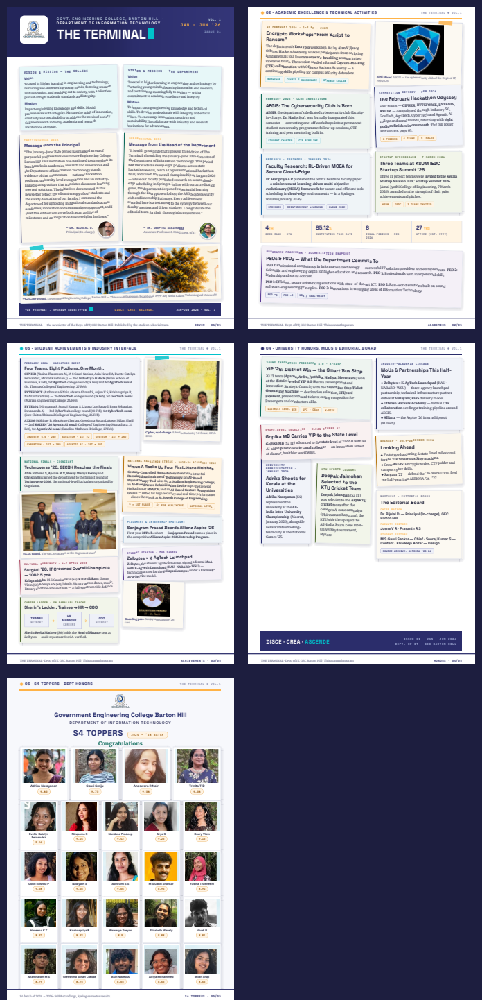

# THE TERMINAL 🖥️

> **Vol. 1 · Jan–Jun 2026 · Issue 01 (Accreditation Series)**
> The newsletter of the **Department of Information Technology, Government Engineering College Barton Hill, Thiruvananthapuram**.



**[📄 Read / download the final PDF](output/THE_TERMINAL_v3_Accr.pdf)**

---

## 📰 What

`THE TERMINAL` is a **5-page, print-ready newsletter** (210 × 297 mm, A4) — the accreditation-season edition covering **January – June 2026**. Five pages, five jobs:

| Page | Section | Contents |
|------|---------|----------|
| 01 | Cover + Desk | Masthead, Vision & Mission (college + department), messages from the Principal & HoD, campus landmark |
| 02 | Academic Excellence & Technical Activities | Faculty paper in *Safety Science* (Elsevier), NSA/Cipher club workshops, Aramco CyberPatriot, KSUM IEDC startups, KPI stats strip, PEO & PSO snapshot |
| 03 | Student Achievements & Industry | February hackathon sweep (4 teams, 8 podiums), Technoverse '26, Sargam '26 overall championship, career ladders, startup MoU, national hackathon streak |
| 04 | University Honors, MoUs & Editorial Board | YIP 6.0 state winners, photography honors, sports selections, industry–academia linkages, roadmap, editorial board |
| 05 | S4 Toppers | Full honors board: 24 toppers of the 2024 – '28 batch with SGPA standings, rebuilt in the newsletter's template style from the department-supplied graphic |

The identity: an **indigo / teal / amber editorial system** on warm paper, Space Grotesk headlines, Merriweather body copy, JetBrains Mono metadata — designed to look like a printed newspaper, not a slide deck.

## 🎯 Why

Department newsletters usually die in one of two ways: **Canva screenshots that nobody can update**, or **Word docs that look like Word docs**. This project exists to fix both:

1. **Single source of truth.** One HTML file *is* the newsletter. Every fact is set once, in type, and flows to the PDF exactly as written.
2. **Verbatim, badge-scoped data.** Every name, rank, date and heading is lifted **word-for-word** from the department's own source archive (`Source.txt`, `reference_1.txt` — machine-readable text extracts of the official decks). Nothing is paraphrased; nothing outside the **Jan 1 – Jun 30 2026** window made the cut.
3. **Reproducible builds.** `bash build.sh` regenerates the PDF + contact-sheet preview from source. Anyone — next year's editorial team included — can rebuild the issue byte-for-byte.
4. **Accreditation-ready.** Built around the NBA/NAAC story arc (vision, mission, PEOs, PSOs, outcomes) so the pages double as evidence material.

## 🛠 How

### Pipeline

```
Source decks (Department slides)          -- verbatim fact mining + content plan
        │
        ▼
content_plan.md  (page-by-page editorial blueprint)
        │
        ▼
terminal_v3.html  (the entire newsletter — semantic HTML + CSS, @font-face local fonts)
        │
        ▼
WeasyPrint v70 (HTML/CSS → PDF, A4, zero margins, absolute-positioned print grid)
        │
        ▼
output/THE_TERMINAL_v3_Accr.pdf  +  preview_v3.png (pypdfium2 + PIL contact sheet)
```

### Rebuild it yourself

```bash
pip install weasyprint pypdfium2 pillow
bash build.sh
```

That's the whole toolchain. No CI, no JS, no images to configure — fonts and photos are committed so renders are deterministic everywhere.

### The interesting engineering bit (WeasyPrint v70 lessons)

Print-CSS in WeasyPrint has sharp edges, all of which are crystallized into the source as working patterns:

- **The silent content-vanishing bug.** Content lives in one absolutely-positioned `.content` box per page (`top / bottom` constrained). When in-flow children overflow that box, WeasyPrint moves the *entire* following block into a *hidden fragment* under the next page's opaque background — content disappears without any error. The fix is discipline: make content *fit*, verify every page visually, every build.
- **Flex quirks.** `margin-top:auto` inside flex columns misbehaves (dead-center signatures painted mid-card) — solved with absolute-positioned signature blocks. Nested flex cards stretch to giant blank boxes unless pinned with `align-self:flex-start`.
- **Stack spacing without `gap`.** `.stack .story + .story { margin-top }` replaces `gap` in stacks — WeasyPrint's flex `gap` is not trustworthy inside absolutely-positioned parents.
- **The phantom page.** Page height is `296.8mm` against a `297mm` `@page` size — the 0.2mm slack keeps WeasyPrint from spawning a spurious 6th page.

### Data policy

- All achievements, teams, names, dates, point totals and quotes are **verbatim from source**. Source text extracts are included as `Source.txt` and `reference_1.txt`.
- Strict **Jan–Jun 2026 date window**: December/September 2025 events were excluded by design, even when prominent.
- The report-pages of the source decks remain internal; only the text extracts and newsletter are published here.

## 📂 Repository structure

```
├── terminal_v3.html        ← the newsletter (single source of truth)
├── build.sh                ← one-command PDF + preview regeneration
├── imgs/                   ← photos extracted from the source decks + college assets
├── fonts/                  ← Inter, JetBrains Mono, Merriweather, Space Grotesk (bundled, OFL)
├── Source.txt              ← verbatim text extract of the department's source deck
├── reference_1.txt         ← verbatim text extract of the second reference deck
├── content_plan.md         ← editorial blueprint (what goes on which page, and why)
├── instructions.txt        ← original brief by the founder-editor
├── issues/                 ← archive: v1 & v2 drafts (5-page classic layout) + first PDF
└── output/                 ← final PDF + contact-sheet preview (build artifacts)
```

## 👥 Credits

- **Editorial Board (Issue 01):** Dr. Bijulal D. (Principal In-charge, GEC Barton Hill), Dr. Deepthi Sasidharan (Associate Professor & Head, Dept. of IT), Josna V. R. (Assistant Professor), staff-STUDENT TEAM — M S Gauri Sankar, Sooraj Kumar S, Nirupama S, Aathmana S Nair.
- **Fonts:** Inter, JetBrains Mono, Merriweather, Space Grotesk — under their respective open licenses (OFL-family).
- Built with [WeasyPrint](https://weasyprint.org), [pypdfium2](https://github.com/pypdfium2/pypdfium2) and [Pillow](https://python-pillow.org).

---

*THE TERMINAL · Dept. of IT, GEC Barton Hill · Thiruvananthapuram — Disce · Crea · Ascende.*
